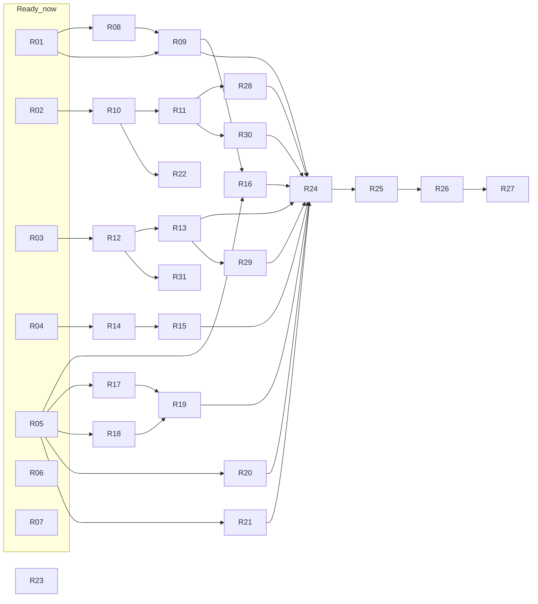

# PD-059 roadmap: from here to the UI_2.0 cutover

One ordered list of the remaining PRs, with their dependencies. Nothing is
assigned. Anyone (Claude or Codex) takes any step whose dependencies are
merged, and claims it on the [status board](PD-059-ui-2-status.md). The board
stays the source of truth for **who** and **state**; this file is the source
of truth for **what comes next** and **what blocks what**.

Spec: [PRD-015](../prds/PRD-015-ui-2.md) · [DD-015](../designs/DD-015-ui-2.md)
· [plan](PD-059-ui-2.md).

## How to use this roadmap

1. Find a step marked **ready** (every dependency merged) that nobody has
   claimed on the board.
2. Claim it: in your first commit on the step's branch, set **Owner**,
   **Branch** and **State = in progress** on the matching board row (steps
   without a slice number get a new row). Never start a step someone holds.
3. A step builds only on **merged** work. If a dependency is in review, take
   another ready step; do not stack on its branch.
4. A **docs** step (a wave plan amendment) is complete code and merges before
   the feature steps it unlocks. Writing one needs no code to be merged, so it
   is always a good step for whoever is free.
5. When the PR merges, set the board row to **merged** and update this file's
   state column in the same PR (or the next docs PR).

Every PR follows the project rules: branch from `main` → `main`, label
`ui-2.0` where it touches UI_2.0, gitmoji, no attribution trailers, frontend
and backend never in one PR, three gates (no regression, adds value, ships a
test that fails without the change).

## Where we are

Merged: shell and picker (1–2), cyber entrance (3), Overview (4–7),
`portfolio_overall` data and backfill command (8, 9a), overall chart component
(10), exchange-rate re-fetch (11–12), History page and dialogs (13–14), ledger
dialog (15), Transactions page (16, #364), trade import (17, #366, with its
handoff-parity follow-up R28, #372), Dividends and dividend import (18–19), Gold
(20–21), act-as (22), Administration, Administrators and Branding (23–24),
Profile (25) and the Light auth screens (26).

## The steps

State: **ready** = every dependency merged, unclaimed. **blocked** = waiting
on the listed steps. **owner** = waiting on an owner action or decision.

| Step | Kind | Scope (board slice) | Depends on | State |
| --- | --- | --- | --- | --- |
| R01 | FE | Overview: grouped holdings, price colours, row dialog with Edit / Ledger / Delete (5) | — | merged (#359) |
| R02 | docs | Wave 4b plan: Transactions page and trade import, complete code (16–17) | — | merged (#362) |
| R03 | docs | Wave 5a plan: Dividends page and dividend import (18–19) | — | merged (#369, #371) |
| R04 | docs | Wave 5b plan: Gold table, Details, metrics, prices, missing-price prompt (20–21) | — | merged (#375) |
| R05 | docs | Wave 6 plan: act-as, admin users, super-admin pages, profile, auth screens (22–26); delta sub-route (27) waits on R22 | — | merged (#378) |
| R06 | FE | Fix the symbol **Test** button: a mouse click never sends the quote request (#296) | — | merged (#380) |
| R07 | FE | Guard the History table against page-width overflow (`position: relative`, browser test at 390 / 768 px) | — | merged (#361) |
| R08 | FE | Holding details: costs, income, XIRR, and the existing holding, opening-date and review forms (6) | R01 | merged (#359) |
| R09 | FE | Overview allocation, Currency mix, Holdings / Performance tabs, sector jump (OVW-1), mount `OverallPerformance` (7) | R01, R08 | merged (#360) |
| R10 | FE | Transactions page (16) | R02 | merged (#364) |
| R11 | FE | Trade import: upload, paste, example (17) | R10 | merged (#366) |
| R12 | FE | Dividends page (18) | R03 | merged (#373) |
| R13 | FE | Dividend import: upload, paste, example (19) | R12 | merged (#374, landed by #385) |
| R14 | FE | Gold table (15 columns), Details, modal, metrics (20) | R04, R12 | merged (#376, landed by #385) |
| R15 | FE | Gold prices (daily, 30 days, all months) and missing-price prompt (21) | R14 | merged (#377, landed by #385) |
| R16 | FE | Act-as in UI_2.0 under the banner, gold excluded (22) | R05, R09, R12 | merged (#383) |
| R17 | FE | Admin user list and detail (23) | R05 | merged (#379) |
| R18 | BE | Add DM Sans and Manrope to the allowed fonts with measured fallback faces (the list itself is already exposed) | PD-059-Q-6b-1 | owner |
| R19 | FE | Super-admin pages: Manage admins, Branding (24); new fonts appear when R18 lands | R17 | merged (#381) |
| R20 | FE | Profile (25) | R05 | merged (#382) |
| R21 | FE | Signup, forgot-password and onboarding in Light (26) | R05, PD-059-Q-6e-1 | merged (#384); visual sign-off PD-059-Q-6e-1 open |
| R22 | FE | Investment delta as a Transactions sub-route (27, tentative) | R10, owner | owner |
| R23 | BE | Register migration step `20261118_02` (9b) | owner's production dry run of `migrate overall` | owner |
| R24 | FE | Cutover readiness: a browser test that opens every route in UI_2.0 at 390 and 1280 px, no horizontal overflow, no Classic-only page left | R09, R11, R13, R15, R16, R19, R20, R21, R28, R29, R30 | ready |
| R25 | BE | New accounts default to `ui2`; migration step moves existing `classic` accounts | R24, owner approval | blocked |
| R26 | FE | Remove the Classic shell and pages; Glass stays | R25 | blocked |
| R27 | docs | Close out PD-059: archive the board, update CLAUDE.md architecture notes | R26, R28 | blocked |
| R28 | FE | UI_2.0 trade import handoff parity: upload, paste, example, explicit validation and preview (board slice 29) | R11 | merged (#372) |
| R29 | FE | Dividend add / edit / delete / delete-all dialogs in the handoff's `asset-form` inside `Ui2Dialog` (wave 5a follow-up; today they keep Classic chrome) | R13 | merged (`feat/PD-059-dividend-dialogs`) |
| R30 | FE | UI_2.0 Transactions keeps its filters and offers Try again after a load error, like Dividends (#373 review) | R11 | merged (#387) |
| R31 | FE | Monthly dividend chart labels crowd beyond ~24 months (handoff geometry kept 1:1): thin them or not | R12, owner | owner |

The server already exposes the allowed font list, so R19 shipped on R17 alone
and renders whatever `allowed_fonts` returns. R18 is now only the addition of
DM Sans and Manrope, which needs their font files to measure metric-adjusted
fallback faces (PD-059-Q-6b-1).

## What is left (2026-11-20)

Slices 1–26 and 29, and follow-ups R29–R30, are merged; only these remain before PD-059 closes.

**Ready (no owner input):**

* R24 — the cutover route test (R29 and R30 merged).

**Waiting on the owner:**

* PD-059-Q-5a-1 — Dividends paging: keep the shared `Pager` (shipped) or build the handoff's `← n / m →`.
* PD-059-Q-5b-1 — asset-page dates: app `18-11-2026` (shipped) or handoff `18 Nov 2026`.
* PD-059-Q-6b-1 / R18 — approve downloading DM Sans and Manrope to measure fallbacks; then a backend PR adds them.
* PD-059-Q-6e-1 — visual sign-off of the Light signup / recovery / onboarding screens (#384).
* R31 — whether to thin the crowded monthly dividend chart labels.
* R22 — the tentative investment-delta sub-route (slice 27).
* R23 — the owner's production dry run of `migrate overall`, then register step `20261118_02` (9b).

**After R24:** R25 (owner approves making UI_2.0 the default and migrating Classic accounts) → R26 (remove the Classic shell and pages; Glass stays) → R27 (close-out: archive the board, update CLAUDE.md).

## Dependency map



Plain-text version, one lane per feature area. Lanes are independent, so they
can run in parallel; only the arrows are ordering.

```text
Overview     R01 ─► R08 ─► R09 ──────────────┐
Transactions R02 ─► R10 ─► R11 ──────────────┤
                     └──► R22 (owner)        │
Dividends    R03 ─► R12 ─► R13 ──────────────┤
Gold         R04 ─► R14 ─► R15 ──────────────┼─► R24 ─► R25 ─► R26 ─► R27
Act-as       R05 ─► R16 (also needs R09) ────┤   (owner approves R25)
Admin        R05 ─► R17 ─┐                   │
             R05 ─► R18 ─┴► R19 ─────────────┤
Profile/Auth R05 ─► R20, R21 ────────────────┘
Standalone   R06, R07 (any time)      R23 (after the owner's dry run)
```

## Critical path

R01 → R08 → R09 → R16 → R24 → R25 → R26 → R27. Everything else fits
alongside it. R05 gates the whole admin and auth side, so it is the docs step
to start early. R23 never blocks the UI work.

## Suggested pickup order

When several steps are ready, prefer, in order:

1. A step on the critical path (R01 first).
2. A docs step that unlocks a lane (R02–R05), so feature work never waits for
   a plan.
3. A small standalone fix (R06, R07) when nothing else is ready.

Example with two people: one starts R01, the other writes R02. When R02
merges the second takes R10 immediately while R01 is still in review; when R01
merges, either takes R08.

## Reuse before building

Check the components registry on the status board before every step. Steps that
render a dialog use `Ui2Dialog` and the shared dialog button design
(`ui2/dialogButtons.css`); steps that edit a ledger use `useHoldingLedger`.
Add a registry row in the PR that creates a shared piece.

## Done when

All steps are merged, R24's route test passes on `main`, the owner has approved
R25, and UI_2.0 is the default interface with Glass still available.
